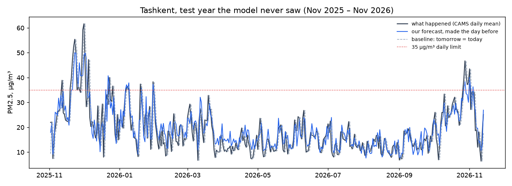
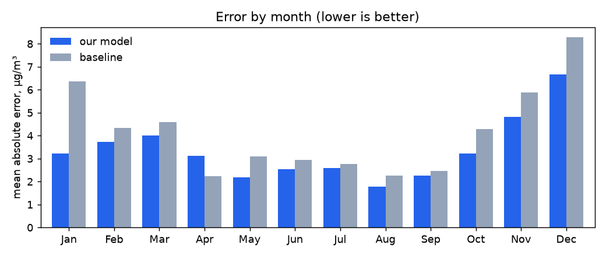

# Tashkent Air for Schools: should tomorrow's PE class be outdoors?

**Track:** AI + Climate
**Team:** Komron Rustamjonov, Academic Lyceum by TTPU, Tashkent (solo)

> This project is a prototype, not health advice. PM2.5 values come from a computer model (CAMS), not from measuring stations.

## The problem
Tashkent's winter air is often unhealthy: when heating starts and the wind drops, fine dust (PM2.5) builds up for days. A PE teacher has to decide **the evening before** whether tomorrow's class goes outside, and children breathe harder during exercise. Today they decide by looking out of the window, which tells them about today, not tomorrow.

## What we built
A next-day PM2.5 forecast for Tashkent that turns into one sentence of advice.

- **In:** the last 7 days of PM2.5 and weather for Tashkent, plus tomorrow's weather forecast (all fetched live from Open-Meteo).
- **Out:** tomorrow's expected daily PM2.5 and advice: *"Move outdoor PE indoors"* or *"Outdoor PE looks fine"*, with the reasons (today's level, tomorrow's wind and rain, heating season).
- **Use:** run `python app.py` and press *Forecast tomorrow*, or replay any day of the test year to see the forecast next to what happened.

## What we added
We started from the brief's suggested project *4.3.2 Next-day air quality forecast* and added:

1. **Our own user and decision:** a school PE teacher in Tashkent, deciding the evening before.
2. **Our own question: does it still work with a real weather forecast?** Models that use tomorrow's weather are usually tested with the weather that actually happened, which is a perfect forecast nobody has. We trained on observed weather, then tested with the **real day-ahead forecasts that were issued at the time** (Open-Meteo Previous Runs archive).
3. **A warning threshold chosen for schools:** a missed smog day with children exercising outside is treated as 3 times worse than moving one class indoors. The threshold was chosen on the training years only, then checked on the test year.

## How it works
**Data.** Hourly PM2.5 for central Tashkent (41.31° N, 69.28° E) from the Open-Meteo Air Quality API (CAMS global model), October 2022 to November 2026, averaged into 1,505 days. Hourly weather (temperature, humidity, rain, pressure, wind, mixing height) from the Open-Meteo Historical Weather API (ERA5). No values were missing except mixing height (12%, filled by the model). Measured data from the US Embassy monitor was our first choice, but its public feed stopped in March 2025.

**Split.** Train: October 2022 to October 2025 (1,121 days). Test: 1 November 2025 to 13 November 2026 (377 days), never shuffled, never seen during training.

**Features (known by the evening).** Today's mean, maximum and evening PM2.5; yesterday, 3-day and 7-day averages; today's weather; season and heating-season flag; tomorrow's forecast temperature, rain, wind and humidity.

**Model.** Gradient boosting (scikit-learn `HistGradientBoostingRegressor`). We also tried ridge regression. Baselines: *tomorrow = today* (persistence) and *the average for that month*.

## Results (test year, 377 days)
| Forecast | Mean error, µg/m³ | Winter (Nov–Feb) | Smog days caught (of 27) | False alarms |
|---|---|---|---|---|
| Baseline: tomorrow = today | 4.19 | 6.24 | 17 | 10 |
| Baseline: monthly average | 6.49 | 9.69 | 0 | 0 |
| Our model, perfect weather | 3.28 | 4.58 | 18 | 6 |
| **Our model, real forecast** | **3.39** | **4.65** | 18 | 9 |
| **Our model, real forecast, school warning (32.5)** | 3.39 | 4.65 | **21** | **13** |
| Baseline, same school warning | 4.19 | 6.24 | 21 | 18 |

- With real forecasts the model is **19% more accurate than the baseline overall and 25% in winter**. Real forecasts cost only 0.11 µg/m³ compared with perfect weather, so the result holds up in practice.
- With the school threshold, both catch 21 of 27 smog days, but our model gives **5 fewer false alarms** (13 against 18).
- Without its own threshold, the model is too cautious at 35: it smooths peaks and misses 9 smog days.




**Where it fails.** The biggest errors are at the **start and end of smog episodes**. On 30 November 2025 we forecast 40.9 µg/m³ and it reached 59.3. On 3 December we forecast 48.2 and the air cleared to 28.3. The model mostly follows recent days, so it is a day late when the weather suddenly turns. In April the model is worse than the baseline (3.13 against 2.23), probably because of spring dust events that today's data cannot predict. The bigger limitation is the data itself: CAMS is a global model with coarse resolution (about 40 km), so it may smooth out city pollution, and we could not check it against measurements. Its Tashkent average is only 18 µg/m³ and just 6% of days exceed 35, so the real number of smog days may be higher than we report.

## What we'd do next
1. Check CAMS against real measurements (Uzhydromet or IQAir monitors in Tashkent) and correct its bias, so the advice uses real levels.
2. Send the advice to teachers automatically every evening, for example through a Telegram bot.

## How to run
```
pip install -r requirements.txt
python src/fetch_data.py      # download data (about 1 minute)
python src/train.py           # train and evaluate, writes outputs/
python src/figures.py         # charts
python app.py                 # demo at http://127.0.0.1:7860
```

## Use it for another city
The model is trained for one city at a time. A model trained on Tashkent is not valid anywhere else, so a new city always needs its own data and its own training run.

1. Open `src/config.py` and set `CITY` to one of the presets (`Tashkent`, `Samarkand`, `Andijan`, `Nukus`), or add your city with its latitude, longitude, time zone and heating-season months.
2. Re-run the pipeline: `python src/fetch_data.py`, `python src/train.py`, `python src/figures.py`. The school warning threshold is chosen again from the new city's training years.
3. Run `python app.py`. The app, the advice and the charts use the new city's name.

This overwrites `data/` and `outputs/`, which hold the Tashkent results described above, so keep a copy if you need them. Check how many days in the new test year are above 35 µg/m³: in a cleaner city there may be too few to judge the warnings. A quick check for Samarkand (14 Nov 2026) gave a mean error of 2.39 against 3.24 for the baseline, but only 1 day above 35 µg/m³ in its test year, so its warnings could not be evaluated.

## Sources
- PM2.5: [Open-Meteo Air Quality API](https://open-meteo.com/en/docs/air-quality-api), based on [CAMS global atmospheric composition forecasts](https://atmosphere.copernicus.eu/) (Copernicus, ECMWF). CC BY 4.0.
- Weather: [Open-Meteo Historical Weather API](https://open-meteo.com/en/docs/historical-weather-api) (ERA5, Copernicus Climate Change Service) and [Open-Meteo Previous Runs API](https://open-meteo.com/en/docs/previous-runs-api) for archived day-ahead forecasts. CC BY 4.0.
- Live forecast: [Open-Meteo Forecast API](https://open-meteo.com/en/docs).
- 35 µg/m³ daily limit: [US EPA PM2.5 standard](https://www.epa.gov/pm-pollution/national-ambient-air-quality-standards-naaqs-pm).
- End of US Embassy air data: [Kun.uz, 7 March 2025](https://kun.uz/en/news/2025/03/07/us-embassies-to-stop-sharing-air-quality-data-amid-budget-cuts).
- Libraries: pandas, scikit-learn, matplotlib, Gradio, requests, joblib.
- AI tools: [Claude Code](https://claude.com/claude-code) (Anthropic) helped write the code, this write-up and the demo video. The video narration uses a Microsoft text-to-speech voice via [edge-tts](https://github.com/rany2/edge-tts). I checked, ran and can explain every step.
